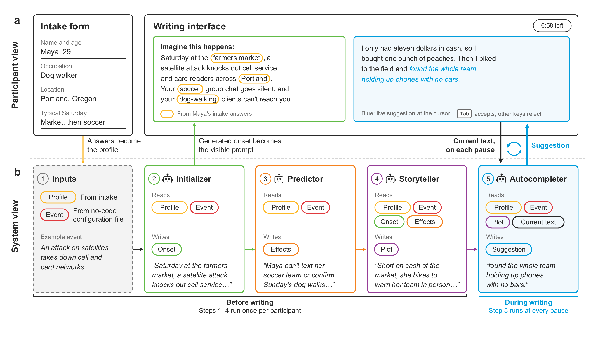

# The As If Machine

A writing app where a language model autocompletes a participant's story as if they had lived through a hypothetical event. We built it to test whether imagining how a policy would play out in your own life changes how close the issue feels and whether you support the policy.

Participants answer a short intake form, read a scenario written for them, and write a first-person story while the model suggests the rest of each sentence. The app logs each suggestion, whether the participant took it, and the final story.

To design a scenario, start with the [scenario guide](docs/AIM_SCENARIO_GUIDE.pdf) (8 pages).

## Citation

If you use the As-If Machine in your research, please cite our paper:

**The As-If Machine: Personalized counterfactuals make distant policy risks feel close.** [Read the preprint](https://www.researchgate.net/publication/416710869_The_As-If_Machine_Personalized_counterfactuals_make_distant_policy_risks_feel_close).

```bibtex
@article{ashkinaze2026asif,
  title = {The As-If Machine: Personalized counterfactuals make distant policy risks feel close},
  author = {Ashkinaze, Joshua and Zhou, Yubo and Chen, Pengyu and Bhattacharya, Avi and Park, Hyebin and Zhang, Yanman and Preston, Stephanie and Gilbert, Eric and Budak, Ceren},
  year = {2026},
  note = {Preprint},
  url = {https://www.researchgate.net/publication/416710869_The_As-If_Machine_Personalized_counterfactuals_make_distant_policy_risks_feel_close}
}
```

## How it works



Panel a shows what the participant sees. They fill out an intake form, then continue a scenario prompt the system built from their answers (orange outlines mark details taken from the intake). Whenever they pause, the system suggests a continuation, which they accept with `Tab` or ignore by typing.

Panel b shows what the system does. Four steps run once, before writing begins. The system turns the intake answers into a text profile (1). The Initializer writes how the event begins for this person, which becomes the prompt above the editor (2; `start` in the code). The Predictor forecasts how the event would affect them (3; `effects`). The Storyteller combines the onset and the effects into a plot (4; `plot` or `plot_from_effects`). While the participant writes, the Autocompleter reads the profile, the event, the plot and the text so far, and suggests the rest of the sentence at every pause (5).

Two settings in `config.yaml` control the design. `shown_to_user` picks which generated text the participant reads above the editor (or `none`), and `autocomplete_context` picks which one the autocompleter is conditioned on. They are independent, so you can show a short plot while conditioning suggestions on the longer one, or show nothing and let the scenario reach the participant only through the suggestions.

## Quickstart

You need Python 3.11 or newer and an API key for a model provider. You don't need a database to try it.

```bash
git clone https://github.com/josh-ashkinaze/asif-machine.git
cd asif-machine
python3 -m venv .venv
source .venv/bin/activate
pip install -r requirements.txt
cp .env.example .env
```

Put your key in `.env`, then run:

```bash
python app.py
```

Open http://localhost:5001. You land on the intake form for the first example scenario. Other examples have their own URLs, such as http://localhost:5001/user_settings_experiment/example_3_tokens_and_custom_intake.

The examples use OpenAI, but both models in `config.yaml` (`llm.model` and `event.effects_generator_model`) can be anything [LiteLLM](https://docs.litellm.ai/docs/providers) supports. Set them to that provider's model names and add its key to `.env`:

| Provider | Key in `.env` | Model names look like |
|---|---|---|
| OpenAI | `OPENAI_API_KEY` | `gpt-...` |
| Anthropic | `ANTHROPIC_API_KEY` | `claude-...` |
| Google Gemini | `GEMINI_API_KEY` | `gemini/...` |
| Meta Llama | `LLAMA_API_KEY` | `meta_llama/...` |
| DeepSeek | `DEEPSEEK_API_KEY` | `deepseek/...` |
| Moonshot | `MOONSHOT_API_KEY` | `moonshot/...` |

Without a MongoDB connection the app prints `NO MONGO URL SET -- skipping save` and throws the data away. See [Saving data](#saving-data).

## Writing a scenario

Each scenario is one key under `event:` in `config.yaml`. The only required field is `name`, the scenario text:

```yaml
event:
  my_event:
    name: >
      You win $50,000 in a state lottery drawing.
```

`config.yaml` ships with five commented examples, from simplest to most complex, that show custom intake questions, bracket tokens like `[state]` that pick up intake answers, `[Tip: ...]` instructions to the model, and the display settings above. The comments in `config.yaml` document every field, and the scenario guide walks through a full example. The prompts themselves are in `prompts.yaml`.

Restart the app after editing `config.yaml`; it loads once at startup. To see what the model makes of a scenario without clicking through the app, run `python tests/test_prompt.py` and type `help`.

## Running a study

Send each condition's participants to `/user_settings_experiment/<event_key>`. To record your survey platform's participant ID, add it to the link as `?pid=`, for example from Qualtrics with Prolific:

```
https://[railwayname].up.railway.app/user_settings_experiment/my_event?pid=${e://Field/PROLIFIC_PID}
```

The app saves it as `auto_pid`. When time runs out, the editor shows `timer.message_to_display_when_time_is_up`, or `timer.message_when_under_min_words` if the participant wrote fewer than `autocomplete.min_words` words. Put your completion codes in those messages.

Before launching, set `lab_mode: true` and run a few sessions yourself. It adds a slider for the pause length before a suggestion appears. Turn it off before recruiting.

## Saving data

The app writes to MongoDB (a free [Atlas](https://www.mongodb.com/atlas) cluster works). Set `MONGO_WORKING_STAGE_URL` in `.env` when running locally and `MONGO_URL` when deployed. Data goes to the `user` database: `user-data` holds one document per intake submission, `journal-data` holds each finished story with its suggestion history and acceptance stats, and `error-log` holds model API errors. A session `uuid` links the three.

To pull data back out:

```python
from datetime import datetime
import mongo_util

docs = mongo_util.retrieve_database_data(
    "production", "journal-data", event_id="my_event", start_date=datetime(2026, 1, 1)
)
```

The first argument picks `MONGO_WORKING_STAGE_URL`, `MONGO_STAGING_URL` or `MONGO_PRODUCTION_URL`.

## Deploying

On [Railway](https://railway.app):

1. Clone this repository.
2. Create a Railway project and deploy it, either with `railway up` from your clone or by connecting your own fork on GitHub. Railway picks up the `Procfile`.
3. Set `OPENAI_API_KEY` (or your provider's key), `FLASK_SECRET_KEY` and `MONGO_URL`. Give staging and production separate `MONGO_URL` values so pilot data stays out of your real dataset.
4. Generate a public domain under Settings → Networking. Study links then look like `https://[railwayname].up.railway.app/user_settings_experiment/<event_key>`, and a staging service gets its own domain, such as `https://[railwayname]-staging.up.railway.app`.

Set `FLASK_SECRET_KEY` to a fixed value. Otherwise the app makes a new one at each restart and every live session breaks. Elsewhere, use the `Dockerfile` or run `gunicorn -w 2 --timeout 120 -b 0.0.0.0:$PORT app:app`. Keep the timeout long, because the intake step makes several model calls before the editor loads.

## Tests

```bash
pip install -r requirements-dev.txt
pytest tests/test_app.py -q
```

Some tests call the real model, so they need an API key and cost a few cents per run.

## License

[PolyForm Noncommercial 1.0.0](LICENSE). You can use, change and share the code for research, teaching and other noncommercial purposes. For commercial use, contact the authors.
